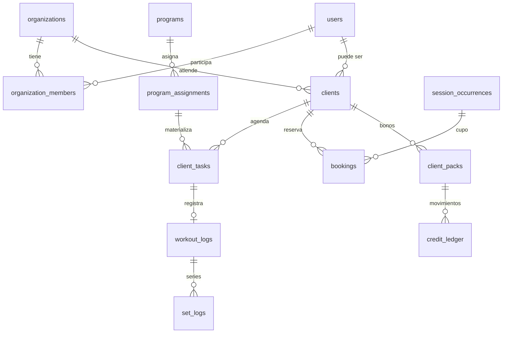

# Modelo de dominio

Los ids son `serial` enteros. Las filas que se pueden crear sin conexión llevan además `sync_id uuid` con `UNIQUE(organization_id, sync_id)`.

`[G]` es tabla global. `[L]` es ledger de solo inserción. El resto extiende la entidad de tenant (`organization_id`, auditoría y borrado lógico).

## Identidad

`organizations [G]`: nombre, slug único, timezone IANA (default Buenos Aires), locale, moneda, sistema de unidades, color, logo, estado `TRIAL | ACTIVE | SUSPENDED`, plan, cupo de clientes activos y fin del trial.

`users [G]`: email, hash de contraseña (nullable hasta aceptar la invitación), `token_version`, flag de admin de plataforma.

`refresh_tokens [G]`, `password_reset_tokens [G]`.

`organization_members`: rol `OWNER | COLLABORATOR`, permisos, estado y color de calendario. Único por `(organization_id, user_id)`.

`invitations` y `invite_links`.

## Archivos, clientes y entrenamiento

`files`: storage key, mime, tamaño, dimensiones y checksum. Propósito: foto de progreso, documento, imagen de ejercicio, avatar, logo o portada.

`clients`: estado guardado `LEAD | INVITED | ACTIVE | ARCHIVED`, acceso a la app, origen, objetivo, altura y última actividad. Staff asignado, tags, perfil de salud 1:1 (PAR-Q y consentimiento), notas y documentos.

`exercises`: `organization_id` nulo significa catálogo global. Tipo de registro `WEIGHT_REPS | REPS | TIME | DISTANCE | TIME_DISTANCE`. Músculos, equipamiento, media y favoritos. Los maestros de músculos, equipamiento y categorías son globales.

`workouts`: modo `NORMAL | SIMPLE`, kind `LIBRARY | CLIENT`. Bloques `STRAIGHT | SUPERSET | CIRCUIT`. Las series van en jsonb.

`programs`: semanas, programa siguiente y días para auto-archivar. Tareas por `day_index`. Al asignar se crean `client_tasks` (`PENDING | COMPLETED | SKIPPED`, `is_customized`).

## Registro, progreso, agenda y bonos

`workout_logs` (con `sync_id`), `exercise_logs` y `set_logs`. Los récords se actualizan en la misma transacción.

`metric_definitions` (nulo en organización = las 15 del sistema), `body_measurements` en métrico, objetivos y fotos de progreso.

Agenda: ubicaciones, tipos de sesión, políticas, series de recurrencia, ocurrencias materializadas, disponibilidad, reservas y lista de espera FIFO.

Bonos: definiciones, packs del cliente (`credits_balance >= 0`) y `credit_ledger [L]` (`GRANT | BOOKING_DEBIT | CANCELLATION_REFUND | ADJUSTMENT | EXPIRY | REFILL`).

Transversal: `activity_events [L]` y `notifications`.

## Copia al asignar

Al asignar un programa se crea una tarea por día (`scheduled_date = inicio + day_index`) y una copia de cada rutina con kind `CLIENT`. El historial no cambia por debajo. "Actualizar para todos" solo toca tareas futuras, pendientes y no personalizadas.

## Ocurrencias

Una serie se expande en su zona horaria, en un horizonte móvil de 16 semanas. Las reservas necesitan una fila real. Los turnos 1:1 se calculan como slots y se materializan al reservar. El doble turno lo impide un `EXCLUDE` sobre el rango horario del organizador.

## Relaciones

